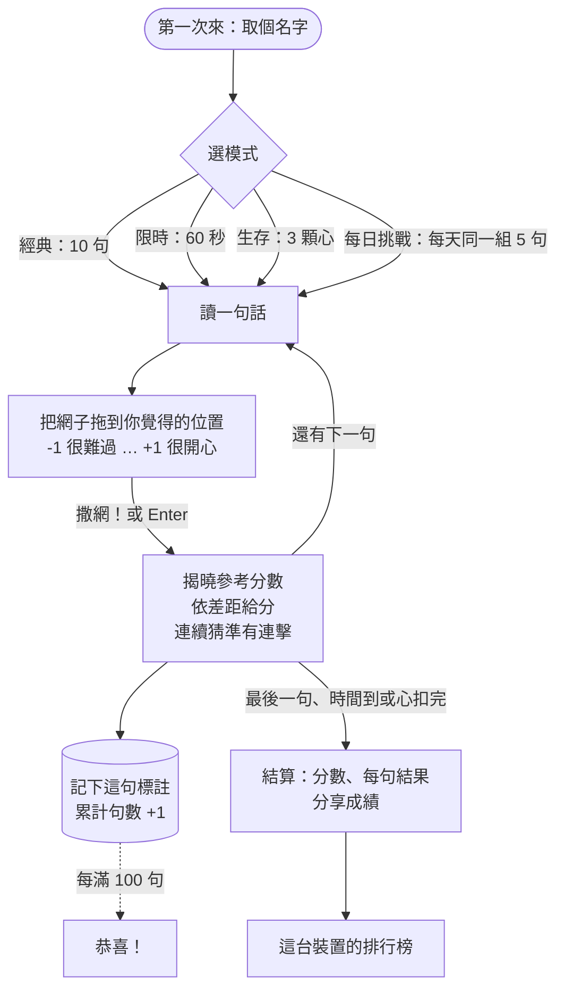
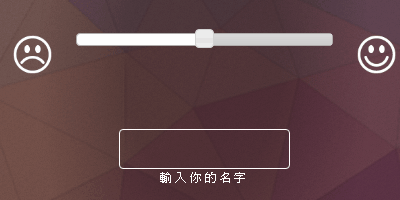
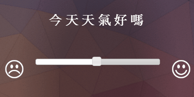
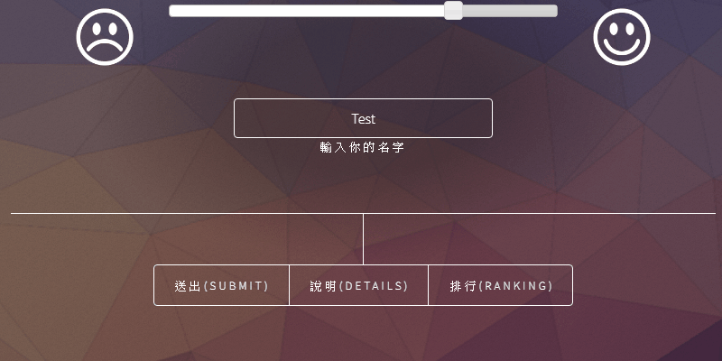

<p align="center">
  <picture>
    <source media="(prefers-color-scheme: dark)" srcset="https://raw.githubusercontent.com/NatLee/word-net-game/master/docs/images/hero-dark.png">
    
  </picture>
</p>

<p align="center">
  <a href="https://github.com/NatLee/word-net-game/actions/workflows/deploy.yml"></a>
  <a href="https://github.com/NatLee/word-net-game/actions/workflows/ci.yml"></a>
  <a href="https://natlee.github.io/word-net-game/"></a>
  
  
</p>

**Word Net** 是一個猜情緒的網頁小遊戲。畫面上出現一句話，你把網子拖到「難過 ↔ 開心」之間你覺得的位置，按下「撒網！」，參考分數就會落下來，越接近分數越高，連續猜準還有連擊加成。不用安裝，打開就能玩：**<https://natlee.github.io/word-net-game/>**

*A small mood-guessing game in Traditional Chinese: read a sentence, cast your net on the sad ↔ happy scale, and see how close you got to the reference score.*

<p align="center">
  <picture>
    <source media="(prefers-color-scheme: dark)" srcset="https://raw.githubusercontent.com/NatLee/word-net-game/master/docs/images/play-desktop-dark.webp">
    
  </picture>
</p>
<p align="center">
  <picture>
    <source media="(prefers-color-scheme: dark)" srcset="https://raw.githubusercontent.com/NatLee/word-net-game/master/docs/images/mobile-dark.webp">
    
  </picture>
</p>

## 怎麼玩

1. 第一次來先取個名字，排行榜和送出的標註都會用這個名字。
2. 在首頁選題庫（全部、日常短句、話中有話、職場、戀愛、網路用語），再選一種模式：
   - **經典**：10 句，沒有時間限制。
   - **限時**：60 秒內答越多越好。揭曉答案時不計時，接著會自動換下一句。
   - **生存**：3 顆心。「失手」扣一顆，連擊每到第 5 句補一顆（最多 3 顆），心扣完就結束，看你能撐多久。
   - **每日挑戰**：每天同一組 5 句，固定從全部題庫挑，大家拿到的題目一樣，一天只能玩一次。玩完可以複製文字成績分享給朋友。
3. 讀完句子，把網子拖到你覺得的位置。最左邊是 -1（很難過），中間是 0（普通），最右邊是 +1（很開心）。
4. 按「撒網！」鎖定答案。參考分數會落在刻度上，畫面告訴你差多少、拿幾分。有些句子（反諷、話中有話）揭曉後會附一句說明。

### 計分

差距是「你的答案」和「參考分數」相減的絕對值，從 0（完全一樣）到 2（剛好相反）。

| 結果 | 差距 | 分數 |
|---|---|---|
| ◎ 完美 | ≤ 0.10 | 100 |
| ○ 很接近 | ≤ 0.25 | 75–89 |
| △ 差一點 | ≤ 0.50 | 50–74 |
| × 失手 | > 0.50 | 0–49（差 1.00 以上是 0） |

連續拿到「很接近」以上就是連擊：第 2 句起每句多乘 0.25 倍，最多 2 倍。例如連續第 3 句很接近、差 0.20，就是 80 × 1.5 = 120 分。每累計判斷滿 100 句，會跳出恭喜畫面。

這些數字都寫在 [`src/config.ts`](src/config.ts)，改那個檔案就能調整規則，遊戲裡的說明和教學會跟著變。

### 鍵盤和無障礙

| 按鍵 | 作用 |
|---|---|
| ← → 或 ↑ ↓ | 網子移動 0.05 |
| Shift + 方向鍵、PageUp／PageDown | 網子移動 0.25 |
| Home／End | 跳到最左（-1）或最右（+1） |
| 1–9 | 直接跳到 9 個固定位置：1 是 -1、5 是 0、9 是 +1 |
| Enter 或空白鍵 | 撒網；揭曉後按 Enter 換下一句 |
| Esc | 關掉對話框 |

- 每一句開始時，焦點會自動放在網子上；揭曉後移到「下一句」，全程不用滑鼠。
- 網子是標準的滑桿元件（`role="slider"`），螢幕閱讀器會念出目前的位置，例如「有點開心（+0.35）」，揭曉結果也會念出來。
- 系統開了「減少動態」時，所有動畫、計分跳動和彩帶都會關掉。
- 深色、淺色可以跟著系統，也可以在右上角切換。
- 手機上用手指拖或點刻度都可以，拖動時頁面不會跟著捲動。

### 分享成績

每種模式玩完都可以「複製成績」；瀏覽器有系統分享功能時（大多數手機都有），還會多一個「分享」按鈕。分享的文字只有每句的結果符號，不會洩漏答案：

```text
Word Net 每日挑戰 2026-11-04
412 分（5 句）
◎◎○△×
最高連擊 3｜平均差距 0.18
https://natlee.github.io/word-net-game/
```

## 遊戲流程



## 你的資料存在哪裡

名字、每一句的答案、排行榜、每日挑戰紀錄和設定，都只存在你的瀏覽器裡（localStorage），遊戲不會把任何東西傳到別的地方。清除這個網站的資料就會消失，排行榜也只是這台裝置上的排行。

## 在本機跑

需要 Node.js 22.13 以上或 24（CI 用 24）。

```bash
npm ci
npm run dev        # 開發伺服器，網址會印在終端機上（預設 http://localhost:5173/）
npm test           # Vitest：計分、題庫檢查、遊戲流程和主要畫面
npm run lint       # ESLint
npm run build      # 型別檢查 + 正式版，輸出到 dist/
npm run preview    # 在本機看 dist/ 的正式版
```

GitHub Pages 的網址在 `/word-net-game/` 底下。部署的 workflow（[`.github/workflows/deploy.yml`](.github/workflows/deploy.yml)）會從 Pages 的設定讀出這個路徑，用 `BASE_PATH` 傳給 build。想在本機模擬一樣的路徑：

```bash
BASE_PATH=/word-net-game/ npm run build
BASE_PATH=/word-net-game/ npm run preview   # 打開 http://localhost:4173/word-net-game/
```

（Windows 的 Git Bash 會把 `/word-net-game/` 改寫成 Windows 路徑，前面再加 `MSYS_NO_PATHCONV=1`。）

push 到 `master` 時，deploy workflow 會跑 lint、測試、build，再部署到 Pages。Pull request 由 [`ci.yml`](.github/workflows/ci.yml) 跑一樣的檢查。

## 新增句子

句子放在 [`src/data/packs/`](src/data/packs/)，一個 JSON 檔是一個題庫。新增一個檔案，裡面的句子就會加進遊戲，首頁的「題庫」也會多一個選項，不用改程式。

```json
{
  "id": "my-pack",
  "title": "我的題庫",
  "language": "zh-TW",
  "source": "原創：為 word-net-game 撰寫的句子和參考分數。",
  "license": "CC-BY-4.0",
  "sentences": [
    { "id": "mine-001", "text": "今天的晚餐超好吃！", "score": 0.8, "tags": ["吃"] },
    { "id": "mine-002", "text": "我沒事，真的。", "score": -0.4, "tags": ["話中有話"], "note": "會特別強調「真的」，通常是有事。" }
  ]
}
```

| 欄位 | 規則 |
|---|---|
| `id`（題庫） | 小寫英文、數字和 `-`，不能跟別的題庫重複 |
| `source` | 句子和分數從哪裡來。用別人的資料集時，寫上出處 |
| `license` | 句子和分數的授權，用 SPDX 代碼（例如 `CC-BY-4.0`）。這個資料夾的 [LICENSE](src/data/packs/LICENSE) 說明內建題庫都是 CC BY 4.0；加入別的授權的題庫時，記得一起更新 |
| `sentences[].id` | 小寫英文、數字和 `-`，**所有題庫加起來**不能重複。紀錄和每日挑戰靠它認句子，發佈後不要改 |
| `sentences[].text` | 1–60 個字 |
| `sentences[].score` | 參考分數，-1 到 1，兩位小數 |
| `sentences[].tags` | 顯示在句子下方的小標籤，可以是空陣列 |
| `sentences[].note` | 選填，揭曉後顯示的說明，適合反諷或容易猜錯的句子 |

改完跑 `npm test`。格式有錯時，測試會列出每個問題和位置，例如：

```text
Error: Sentence packs are invalid:
- ./packs/my-pack.json sentences[1].score: must be a number from -1 to 1
```

每日挑戰是從所有句子裡，用日期決定挑哪 5 句。所以加了句子之後，當天和之後的每日題目會跟著改變。

## 題庫和授權

- 五個內建題庫（日常短句 49 句、話中有話 30 句、職場 25 句、戀愛 25 句、網路用語 25 句，共 154 句）的句子和參考分數，都是為這個專案原創的，沒有取自任何資料集或網站。參考分數是一種看法，不是標準答案；猜得跟它不一樣，不代表你錯了。
- **程式碼**用 [MIT 授權](LICENSE)（Copyright NatLee）。
- **句子和參考分數**（[`src/data/packs/`](src/data/packs/) 裡的 JSON）用 [CC BY 4.0](src/data/packs/LICENSE)：可以複製、改寫、商用，只要註明出處，例如「“Word Net sentence packs” by NatLee（https://github.com/NatLee/word-net-game），CC BY 4.0」。每個題庫的 `license` 欄位也寫著它的授權。
- 字型 [Space Grotesk](https://fonts.google.com/specimen/Space+Grotesk) 用 SIL Open Font License 1.1；圖示 [Lucide](https://lucide.dev/) 用 ISC 授權。音效是程式即時合成的，沒有音檔。

## 2018 年的原版

這個遊戲 2018 年的名字是 WordNet，是一個收集「句子情緒標註」的網頁：畫面顯示一句話，玩家用滑桿在難過和開心之間打分數，按送出後把名字、句子和分數寫進 Google 表單；排行榜則讀 Google 試算表，看誰標得最多。

到 2026 年，它已經不能用了：句子來自 Heroku 上的小服務，那個 app 已經不存在；排行榜用的 Google 試算表舊 API 在 2021 年關閉。這次用 React、Tailwind 和 Vite 重做，原本的功能都留著：

| 2018 年 | 現在 |
|---|---|
| 從 Heroku 抓一句話 | 句子放在 repo 裡的題庫，加上參考分數，變成可以計分的遊戲 |
| 滑桿 -1 到 1，兩端是難過和開心的臉 | 一樣的刻度和兩張臉，滑桿換成可以拖、點、用鍵盤操作的網子 |
| 輸入名字，存在瀏覽器裡 | 一樣，第一次來會先問名字，可以在設定裡改 |
| 畫面上方的累計次數、每 100 次恭喜 | 一樣，次數顯示在右上角，每滿 100 句有恭喜畫面和彩帶 |
| 「你確定嗎？」後送到 Google 表單 | 拿掉了：作者已經不再收集標註資料，答案只留在你的瀏覽器裡 |
| 3 步驟 gif 教學 | 3 步驟互動教學，最後一樣是「做得好！我們可以開始了！」 |
| 線上排行榜（每個名字標過幾句） | 這台裝置的排行榜：各模式最高分，加上「標註數」（每個名字標過幾句） |

<details>
<summary>2018 年的 3 步驟教學（原版 gif）</summary>

| 第一步：輸入名字 | 第二步：讀句子、拉滑桿 | 第三步：按送出 |
|---|---|---|
|  |  |  |

</details>

## 專案結構

```text
src/
  config.ts          遊戲規則：計分、模式、時間、里程碑
  data/packs/        題庫（JSON），validate.ts 負責檢查
  game/              純邏輯：計分、發牌、一局的狀態、分享文字
  lib/               瀏覽器相關：儲存、排行榜、音效、深淺色
  hooks/  components/  App.tsx   畫面
docs/images/         README 的圖；src/hero.html 是封面圖的原始檔
docs/2018/           2018 年原版的教學 gif
```
